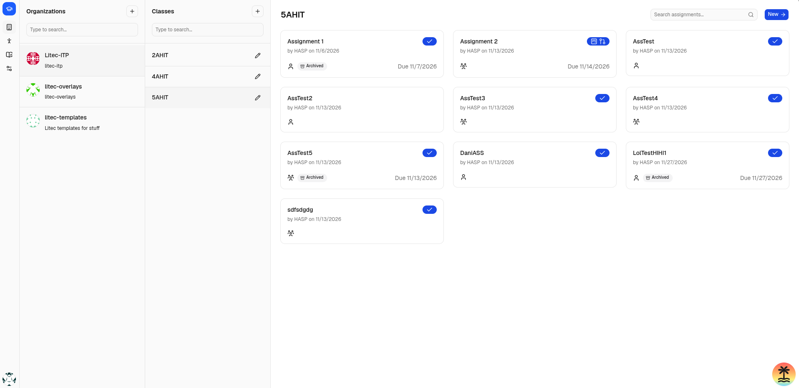
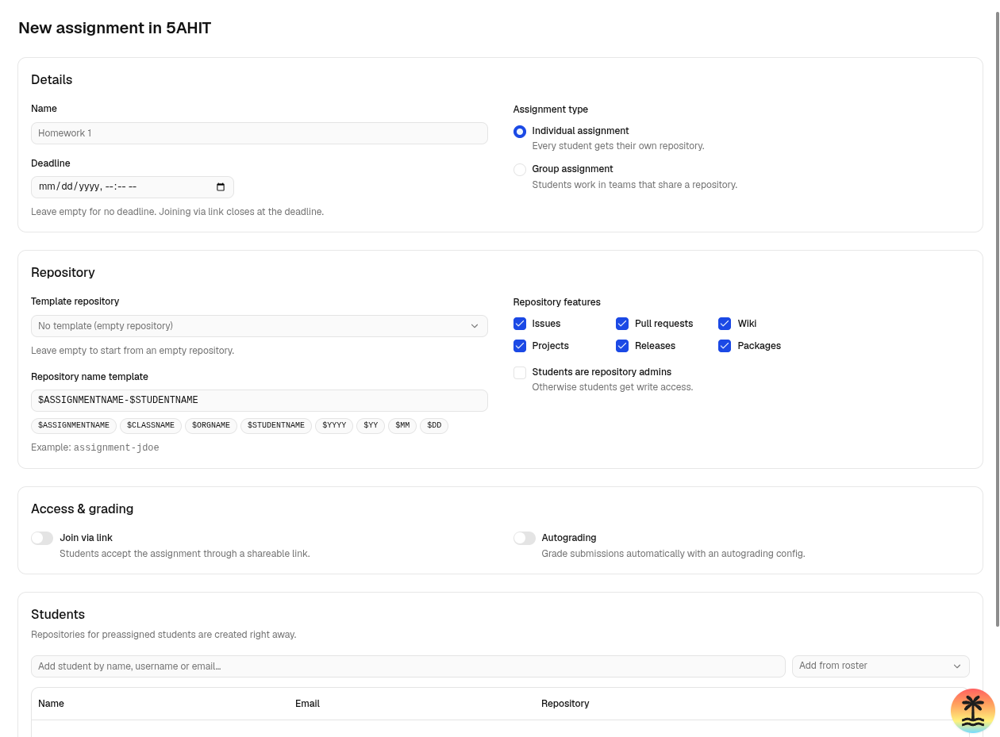

# Athene

A selfhosted classroom solution for ForgeJo

## What is Athene?

Athene is a selfhosted classroom solution for ForgeJo. Athene aims to fill the need for a modern, simple, classroom solution that can be easily selfhosted and is compatible with ForgeJo. Athene aims to fully integrate with ForgeJo where possible to avoid splitbrain problems and provide smooth operation.

## Features

- Organization management: Allows for creating and properly configuring ForgeJo organizations
- Class management: Allows for splitting a Organization into virtual classes
- Assignment management: Create group or individual assignment with deadlines, archiving rules, teams, naming templates, autograding and more.
    - Creation
    - Editing
- Rosters: Create quickly accessible groups of students that can be referenced later. (Assignment creation, Joining restrictions, ...)
- Autograding: Define rules to automatically grade repositories. Requires ForgeJo Actions to work.
- Quota management: A small graphical UI to manage qoutas.

## Setup

The recommended way to run Athene is using [docker](https://www.docker.com/).

Athene also requires a working [ForgeJo](https://forgejo.org/) instance with optionally [ForgeJo Actions](https://forgejo.org/docs/v15.0/user/actions/reference/) if you want to make use of autograding.

To store data, Athene makes use of PostgreSQL. A working example is in the [compose.yaml](https://github.com/GameTec-live/Athene/blob/main/compose.yaml).

It may be helpful to use the provided compose.yaml (found in the repository root).

Some requirement variables are required. When using the provided docker compose, make sure to place a copy of [.env.example](https://github.com/GameTec-live/Athene/blob/main/.env.example) into .env next to the compose file.

The following variables need to be set or double checked:

- `POSTGRES_PASSWORD`: The PostgreSQL password (only relevant for the provided compose file)
- `DATABASE_URL`: The URL to find the database at
- `BETTER_AUTH_URL`: Final URL of the application. Used for securing authentication.
- `BETTER_AUTH_SECRET`: Secret to secure authentication. Use a long and secure secret. Generate using for example `openssl rand -base64 32`
- `FORGEJO_BASE_URL`: The URL to find the forgejo instance at
- `FORGEJO_TOKEN`: Non expiring, long lived, full access ("all") token of the instance administrator account (usually first account created). This is used to perform actions on the forgejo instance.
- `FORGEJO_CLIENT_ID`: Client ID of the OAUTH integration.
- `FORGEJO_CLIENT_SECRET` Client secret of the OAUTH integration.
- `FORGEJO_DISCOVERY_URL`: Discovery URL of the OAUTH integration.

Athene authenticates against forgejo itself. Under "Site Administration" -> "Integrations" -> "Applications" create a new application with a redirect URL to "<https://yourdomainhere.example.com/api/auth/callback/forgejo>". Athene is a confidential client. Enter the generated client secret and ID in the environment variables.

Once everything is ready and running, simply visit the application in a webbrowser and sign in.

## Images

